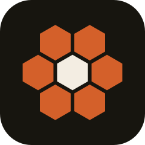
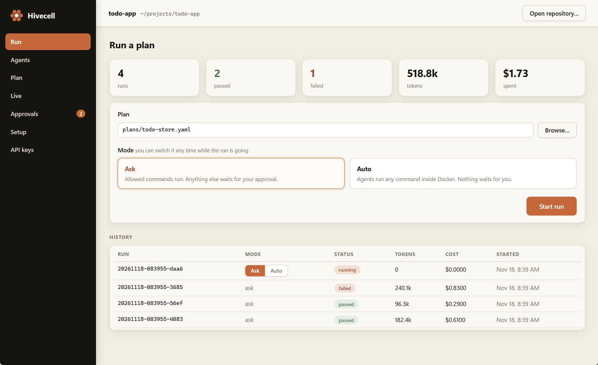
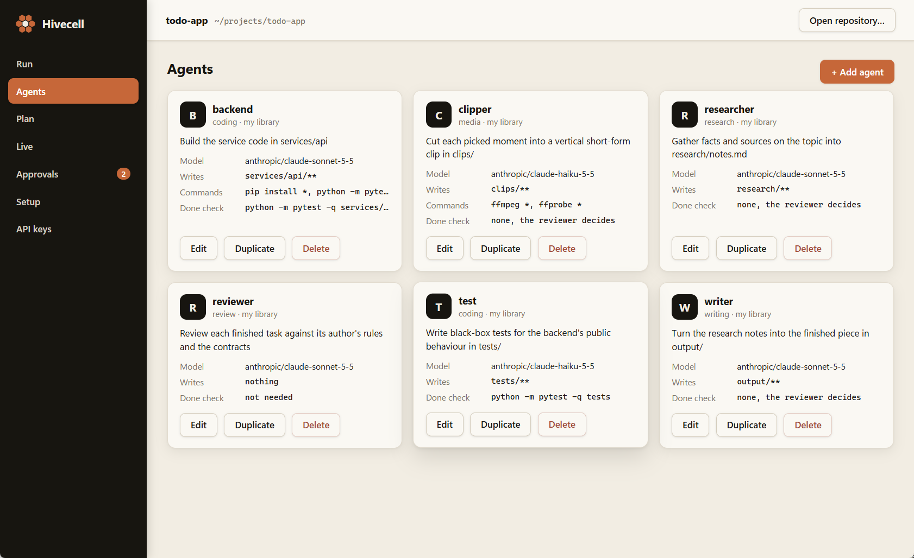
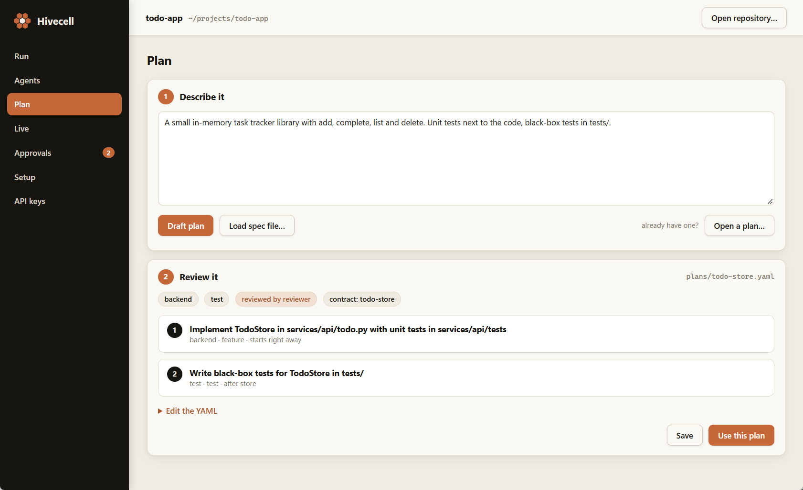
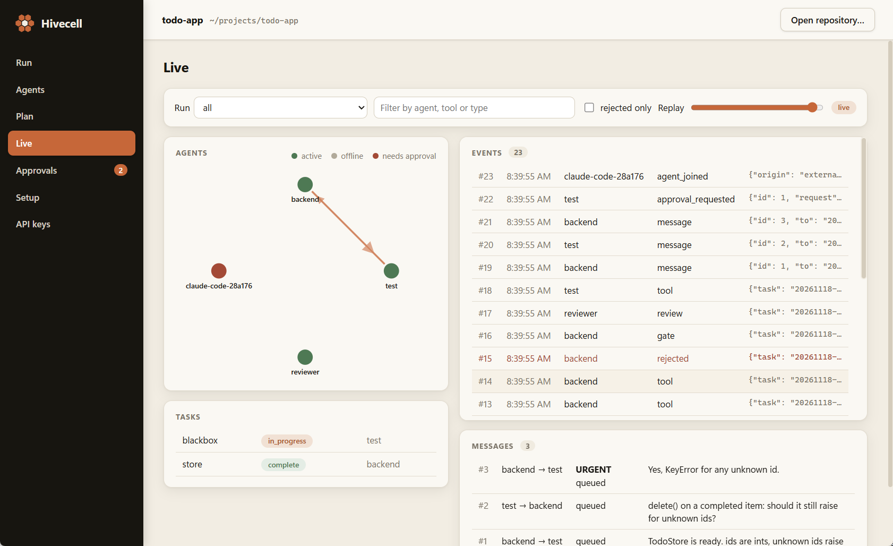
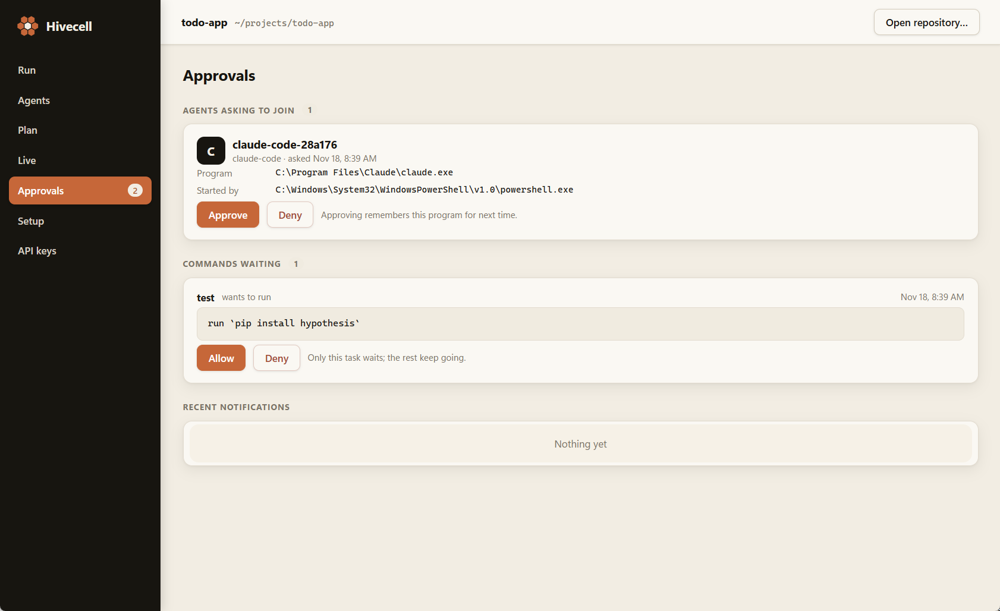
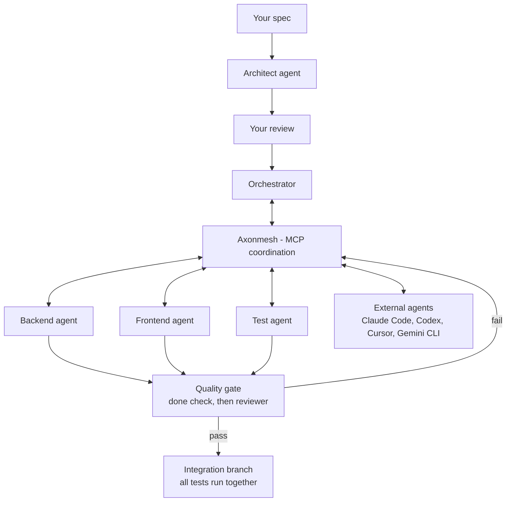

<p align="center">
  
</p>

<h1 align="center">Hivecell</h1>

<p align="center"><strong>A multi-agent harness with a built-in coordination mesh.</strong><br>
Give it a spec. Specialist agents, each with their own rules, build the project in parallel, talk to each other, and ship only what passes tests and review.</p>

<p align="center">Free and open source.</p>

---

<p align="center"></p>

---

## Why Hivecell

Running several AI agents on one repo usually goes wrong in the same ways: they edit the same files, they can't ask each other questions, one overwrites another's unmerged work, and nobody checks the result.

Hivecell fixes that with two parts that work as one system:

- **Harness:** plans the project, starts the agents, enforces their rules, checks their work, and merges it.
- **Axonmesh:** a shared coordination layer (an MCP server) for presence, messaging, file claims, task handoffs and review evidence.

| Without Hivecell | With Hivecell |
|---|---|
| Agents collide on the same files | Each agent's folders are claimed before any agent starts, so overlaps are blocked up front |
| Agents can't talk to each other | Direct messages with replies and delivery receipts |
| Finished but unmerged work gets overwritten | Soft locks protect it, and uncommitted changes in any worktree count as overlaps |
| "Tests pass" is the agent's word | The harness runs the tests itself; review packets label CI results apart from agent claims |
| Rules live in a prompt and get ignored | Rules are enforced in code: a write outside an agent's folders is rejected before it touches disk |

---

## Features

- **Desktop app:** a native window (no browser, no network port) to create agents, plan, run, watch live and approve
- **Agents for any job:** coding, video clipping, research, writing. Describe one in plain words and the AI drafts it, or start from a template
- **Rules file per agent:** role, folders it may write and read, tools, allowed commands, model, token budget, done check
- **Architect agent:** turns your spec into a task graph and contracts; every plan is validated in code before you see it
- **Contracts first:** agents agree on interfaces before coding, so they can work in parallel
- **Isolation:** every agent works in its own git worktree and branch; agent commands run in Docker with no access to your keys
- **Ask or Auto, switchable mid-run:** in Ask mode anything off an agent's allowed list waits for you; flip to Auto and nothing waits
- **Coordination mesh (MCP):** Claude Code, Codex, Cursor and Gemini CLI can join a run, not just Hivecell's own agents
- **You approve every new agent:** unknown MCP clients stay pending until you let them in; identity comes from the connection, so agents can't claim to be someone else
- **Quality gate:** the agent's done check first, then a reviewer agent, then everything is merged and tested together
- **Token ledger:** tokens and cost per agent and per task
- **Any model:** Claude, Gemini, Grok, OpenCode Zen, NVIDIA NIM, OpenAI, or local models through Ollama

---

## Screens

| | |
|---|---|
| <br>**Agents:** create, edit and reuse agents | <br>**Plan:** describe it, review the task graph |
| <br>**Live:** every tool call and message, with replay | <br>**Approvals:** new agents and waiting commands |

---

## Architecture



`main` is never touched: the result lands on `hivecell/<run>/integration` for you to merge.

---

## Quick start

### Download the app (Windows)

1. Download `Hivecell-v0.1.0-windows-x64.zip` from [Releases](https://github.com/abdullah-qadoos/Hivecell-AI-Multi-Agent-Harness/releases/latest).
2. Unzip it anywhere and run `Hivecell.exe`. No Python install needed for the app itself.
3. The app isn't code-signed yet, so Windows SmartScreen may warn the first time: click **More info**, then **Run anyway**.

You also need [git](https://git-scm.com/). Agents whose done check runs Python tests need Python on your PATH, and agents that run commands need Docker.

### Or run from source

You need Windows 10 or 11, Python 3.13+, [uv](https://docs.astral.sh/uv/) and git.

```powershell
git clone https://github.com/abdullah-qadoos/Hivecell-AI-Multi-Agent-Harness.git
cd Hivecell-AI-Multi-Agent-Harness
uv sync
uv run hivecell-app
```

Build the Windows app yourself with `uv run pyinstaller packaging/hivecell.spec --noconfirm` (output in `dist/Hivecell/`).

### First steps in the app

1. **API keys:** add a key for at least one provider (Gemini has a free tier, NVIDIA gives free credits).
2. **Open repository:** any git repo with at least one commit.
3. **Agents:** add agents, from a template or by describing what you need.
4. **Plan:** describe the project and let the architect draft the plan.
5. **Run:** choose Ask or Auto and start. Watch it on **Live**, answer anything on **Approvals**.

### Command line

```powershell
uv run hivecell plan examples/todo_spec.md --repo C:\path\to\repo --out plan.yaml
uv run hivecell run plan.yaml --repo C:\path\to\repo --mode ask
uv run axon --repo C:\path\to\repo events --follow
```

### Mesh-only mode

Coordinate Claude Code, Codex, Cursor or Gemini CLI sessions you run yourself, from the **Setup** screen or the command line:

```powershell
uv run axon --repo C:\path\to\repo setup claude-code   # shows the exact changes, asks, backs up
uv run axon --repo C:\path\to\repo doctor              # read-only check
uv run axon --repo C:\path\to\repo setup --undo        # removes exactly what setup added
```

---

## Rules file example

```yaml
name: backend
category: coding
model: anthropic/claude-sonnet-5-5
role: Build the service code in services/api
owns: ["services/api/**"]                 # the only folders it can write
can_read: ["contracts/**", "docs/**"]
tools: [read_file, write_file, list_files, run_tests, run_command, send_message, read_contracts]
commands: ["pip install *", "python -m pytest*"]   # run without asking in Ask mode
rules:
  - Every public function needs a test
budget: { max_tokens: 400000, max_minutes: 30 }
test_cmd: python -m pytest -q services/api # the done check; leave it out and the reviewer decides
```

Agents live in `~/.hivecell/agents/` (every repository) or `<repo>/.hivecell-agents/` (shared with the repository). Templates are in [`agents/`](agents/).

### Models

`model` is always `provider/model-id`:

| Provider | Example | Key |
|---|---|---|
| Anthropic | `anthropic/claude-sonnet-5-5` | `ANTHROPIC_API_KEY` |
| Google Gemini | `gemini/<model-id>` | `GEMINI_API_KEY` |
| xAI Grok | `grok/<model-id>` | `XAI_API_KEY` |
| OpenCode Zen | `opencode/<model-id>` | `OPENCODE_API_KEY` |
| NVIDIA NIM | `nvidia/<publisher>/<model>` | `NVIDIA_API_KEY` |
| OpenAI | `openai/<model-id>` | `OPENAI_API_KEY` |
| Ollama (local) | `ollama/qwen2.5-coder:7b` | none |

---

## Benchmarks

<!-- Real numbers only. Run the suite and paste benchmarks/results.md here. -->

Not published yet. Five sample projects are built three ways (one agent, a team, a team with a reviewer) and scored by **hidden acceptance tests** the agents never see:

```powershell
uv run hivecell bench --model anthropic/claude-sonnet-5-5
```

Method and sample projects: [benchmarks/](benchmarks/)

---

## Safety

- Agents only write the folders they own; the tool router checks every write.
- Agent commands run in Docker, with only that agent's worktree mounted and no API keys inside.
- In Ask mode, anything not on an agent's allowed list waits for you.
- Messages between agents are marked as untrusted, and can't fake those markers.
- Agents that read the whole repo (architect, reviewer) never read hidden files such as `.env`.
- New MCP agents wait for your approval; the app opens no network port.

---

## Project layout

```
hivecell/      the harness: rules, agent loop, tools, orchestrator, architect, reviewer, desktop app
axonmesh/      the coordination layer: tasks, claims, messages, approvals, MCP server, axon CLI
agents/        agent templates
examples/      sample spec and plan
benchmarks/    benchmark projects with hidden acceptance tests
tests/         57 tests, run with: uv run pytest
```

---

## Roadmap

- [x] Harness: rules enforced in code, agent loop, worktrees, quality gate, integration
- [x] Axonmesh: versioned tasks, claims, messaging with receipts, approvals, MCP server
- [x] Architect and reviewer agents
- [x] Desktop app
- [x] Setup for Claude Code, Codex, Cursor and Gemini CLI
- [ ] Published benchmark numbers
- [ ] Large media files kept outside git for media agents
- [ ] Postgres backend for runs across machines
- [ ] macOS and Linux app builds

---

## Contributing

Hivecell is fully open source, and contributions of any size are welcome: bug reports, ideas, new agent templates, new model providers, or code.

1. Fork the repo and create a branch.
2. `uv sync`, make your change, and run `uv run pytest`.
3. Open a pull request saying what changed and why.

Found a security problem? Please open an issue without the exploit details, and it will be followed up privately.

---

<p align="center">Built by <a href="https://github.com/abdullah-qadoos">Muhammad Abdullah Noor</a> · <a href="https://linkedin.com/in/muhammad-abdullah-noor">LinkedIn</a></p>
